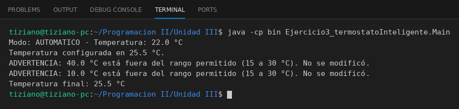

# Termostato

Programación II - Unidad 3 - Ejercicio 3

## Consigna
Modelar la clase aplicando encapsulamiento: atributos privados y métodos públicos que validan antes de modificar el estado. Un termostato con temperatura protegida en un rango de 15 a 30 °C.

## Lógica
- Atributos privados `temperaturaActual` y `modoOperacion`.
- `setTemperatura(nueva)` rechaza valores fuera de 15 a 30 °C, imprime una advertencia y no modifica el estado.
- `getTemperatura()` permite consultar el valor sin exponer el atributo.
- `Main` prueba temperaturas válidas e inválidas.

## Ejecución

